# Sail-Suite

Source code of the web apps at [sail-suite.app](https://sail-suite.app): four tools for a
sailing voyage in the Mediterranean, bilingual (German/English), installable as PWAs for
use at sea without a connection.

| App | Version | Purpose |
|---|---|---|
| **VoyagePlan** · Törnplanung | 5.1.12 | Plans the whole voyage: which harbour on which day |
| **CourseCast** · Tagesplanung | 5.7.2 | Daily weather briefing for a fixed route: when to cast off, what to expect on the way |
| **SailPilot** · TörnNavLog | 6.2.1 | Automatic logbook and backup navigation on the phone already on board |
| **VoyageBook** · TörnBuch | 5.1.10 | Voyage, crew list, crew kitty, statistics and PDFs |

A fifth page, `stream/`, lets people at home follow a shared voyage read-only.

## Screenshots

English interface, day and night view. Voyage, yacht and crew are invented; weather, radar and
official warnings are the real data of the day the pictures were taken.

**Landing page** · day and night

<p>
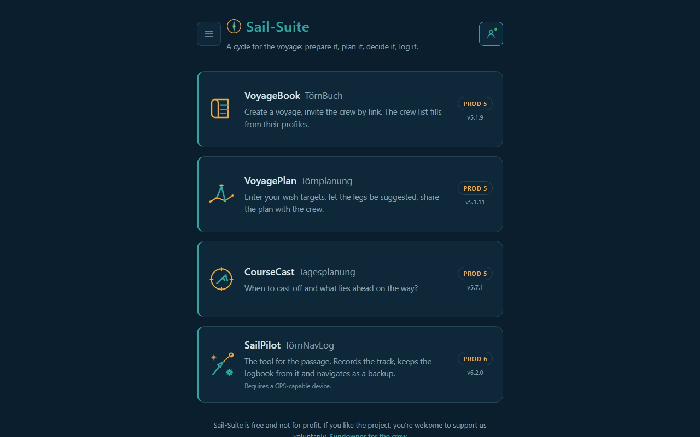
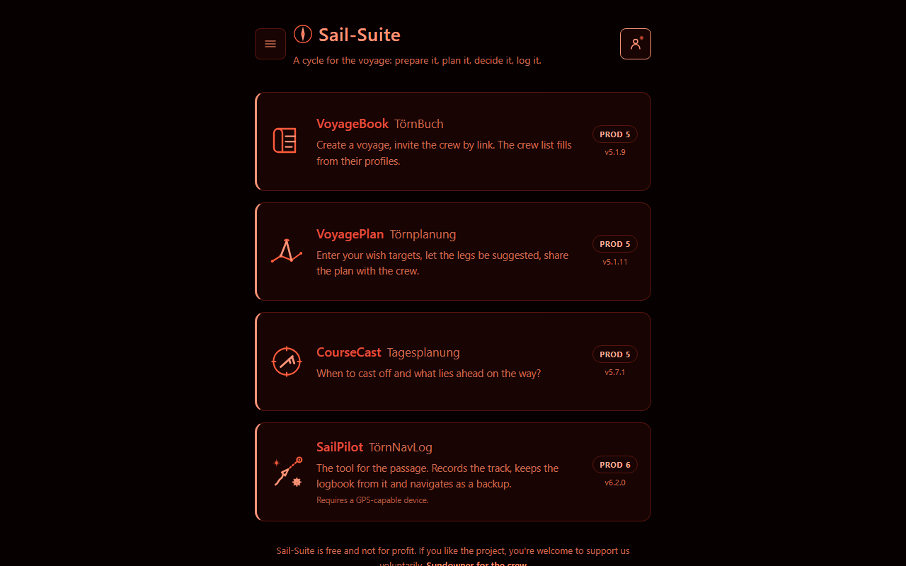
</p>

**VoyageBook** · voyage overview and crew

<p>
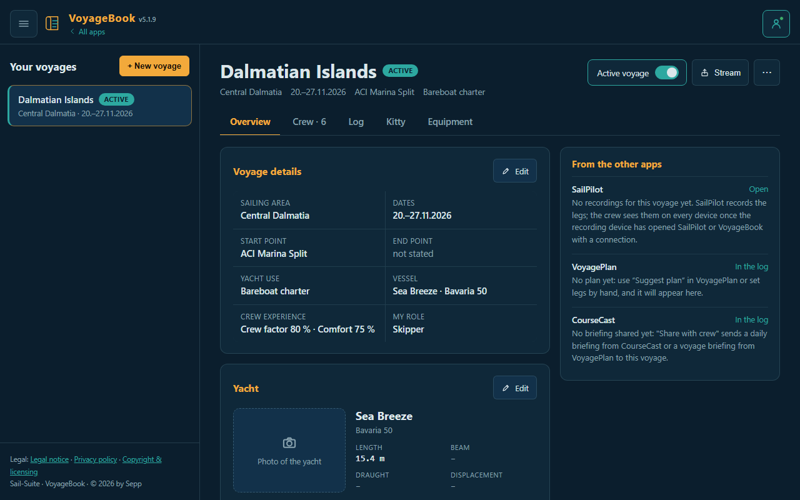
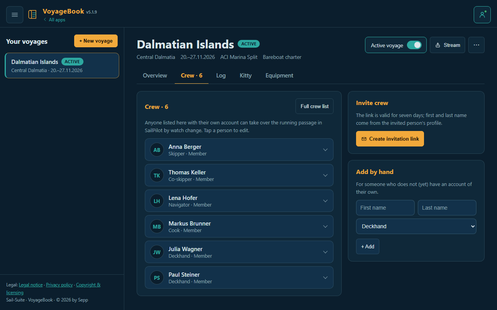
</p>

**VoyagePlan** · wish destinations and the rough pre-check

<p>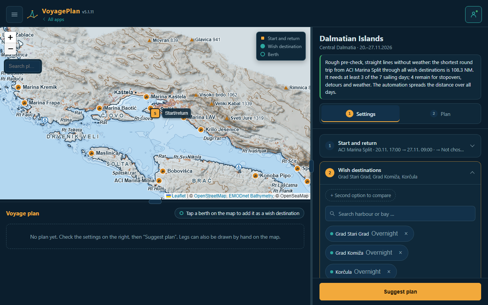</p>

**CourseCast** · daily briefing Split → Stari Grad, aerial view and rain radar, night view

<p>
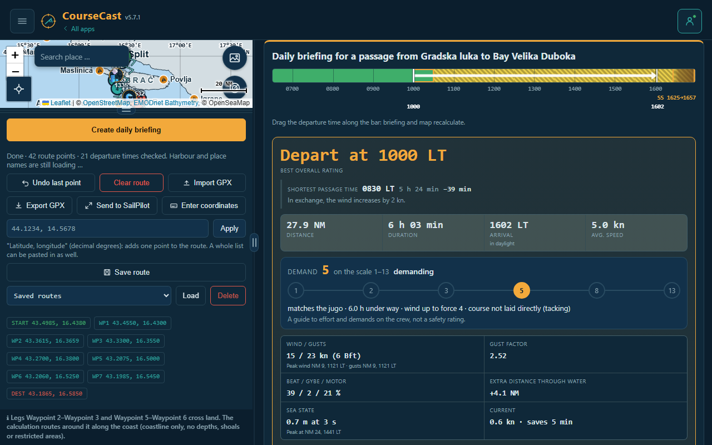
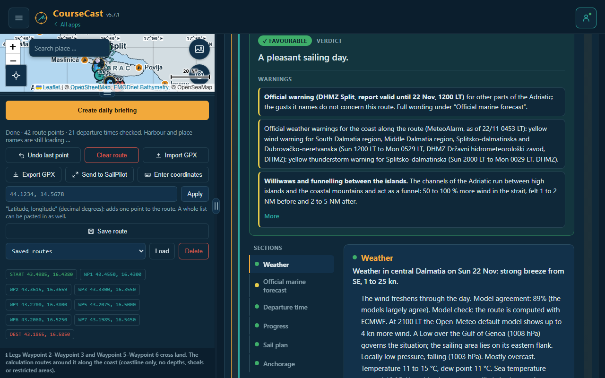
</p>
<p>
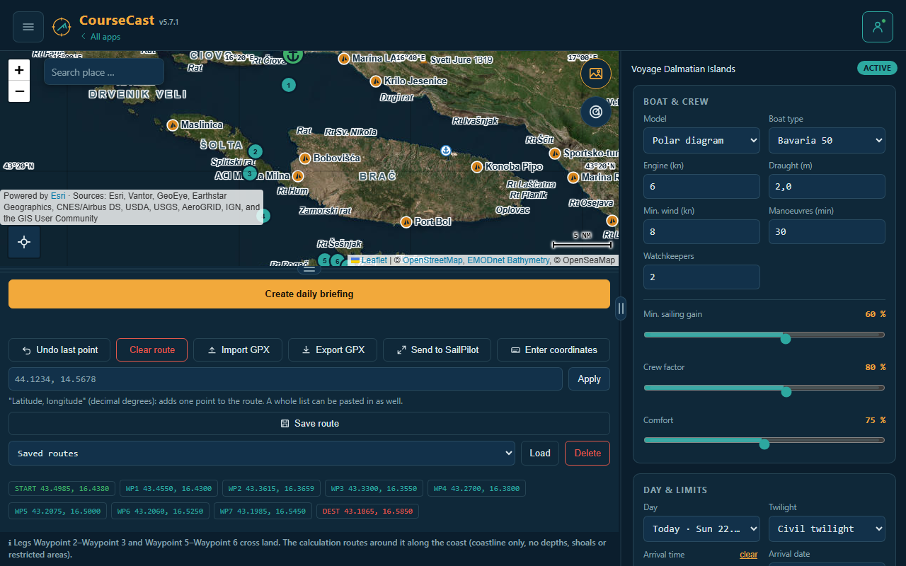
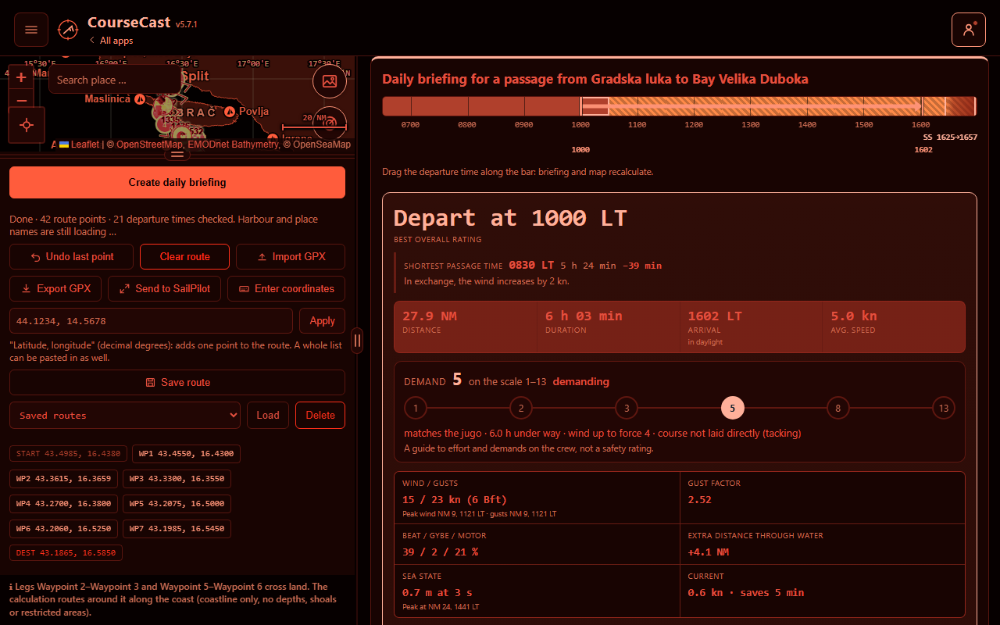
</p>

**SailPilot** · on the phone: route planning, passage with instruments, aerial view, rain radar, gusts
along the route, night view

<p>
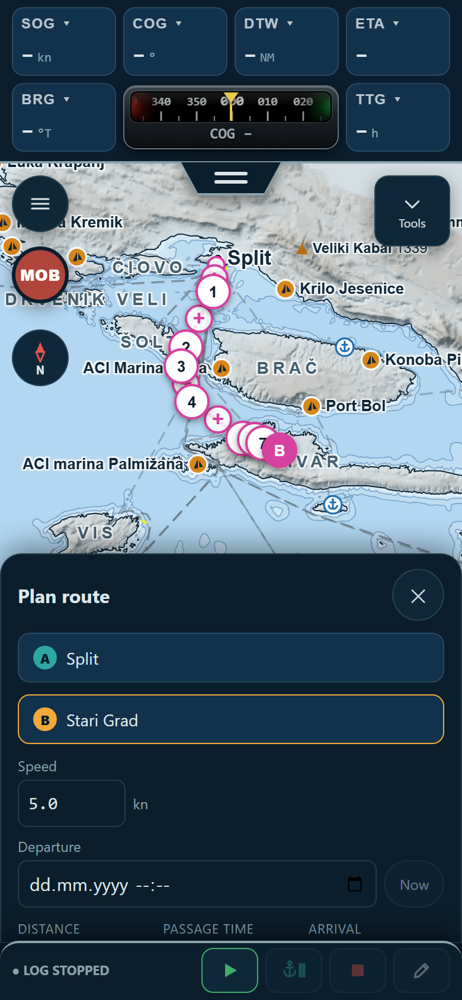
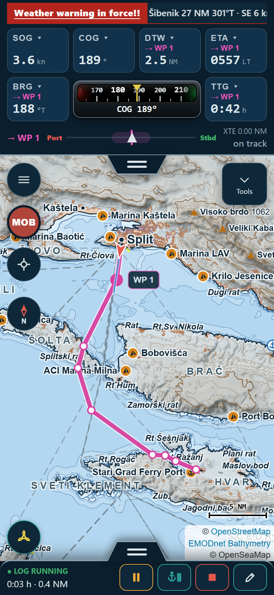
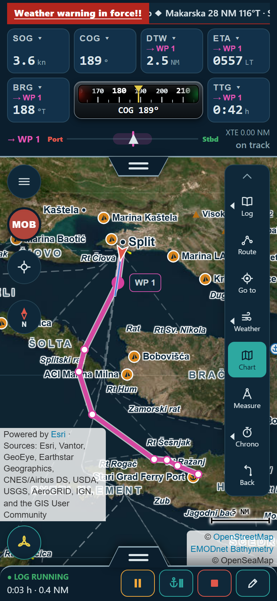
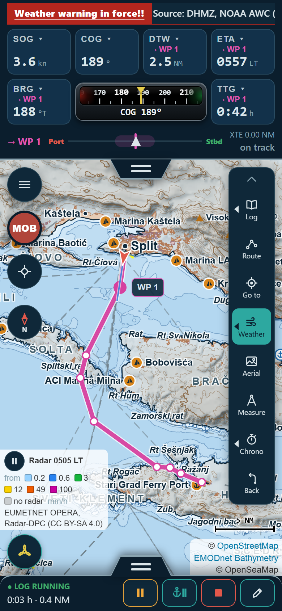
</p>
<p>
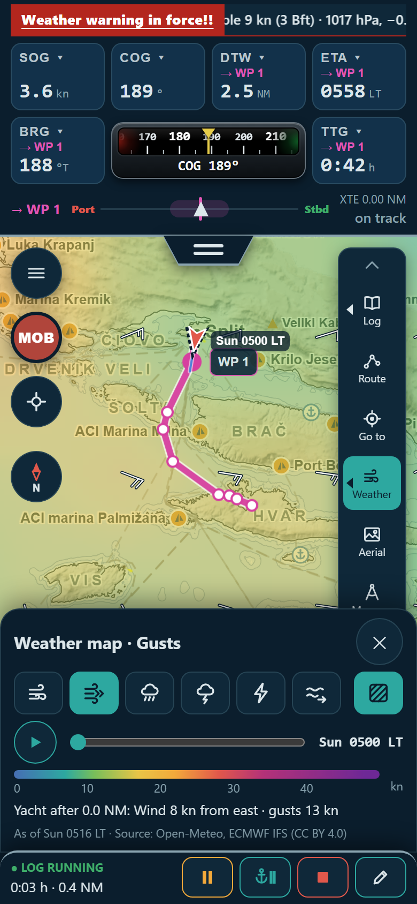
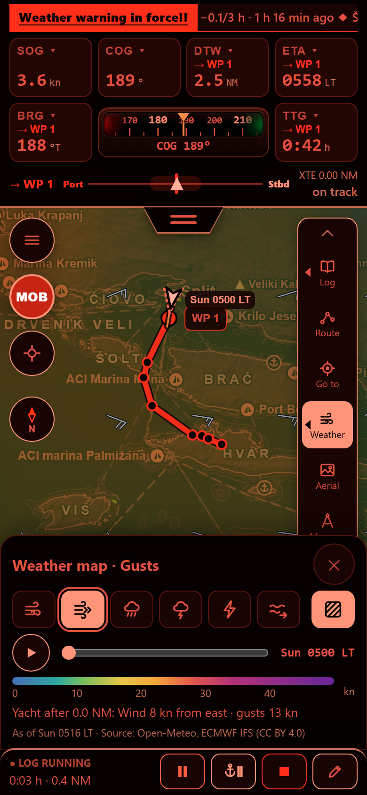
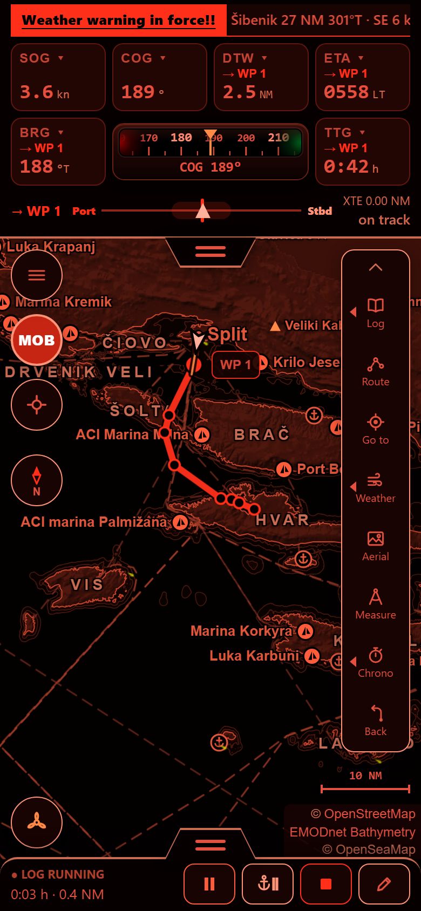
</p>

## Accounts and sync

CourseCast, SailPilot and VoyagePlan require a free account and sit behind
the same login gate; the landing page and VoyageBook's own page stay open to
everyone — an invitation link has to be openable by someone who doesn't have
an account yet. Two ways in:

- **Username, password and email address.** The email is mandatory and must
  be confirmed by a link before the first sign-in; it then goes straight
  into the profile. Passwords have at least 8 characters; "Forgot password"
  sends a reset link by email, and "Change password" sits in the account
  menu. The password never reaches the
  server in plain text: the browser derives a key from it (PBKDF2), the
  server stores only a hash of that key.
- **Google Sign-In.** First name, last name and email are taken into the
  profile. An account without a password is found again by its verified
  email address. An account with a password is never linked
  automatically: the Google sign-in sends you back to sign in with username
  and password, and "Link Google account" in the account menu adds Google to
  the signed-in account after asking for its password, keeping password and
  account email and sending a notice to the account email. "Unlink
  Google" removes it again with the password; a new password from "Forgot
  password" and "Sign out on all devices" also unlink Google from an account
  with a password. A Google-only account cannot be unlinked.

One voyage, created in VoyageBook, is the shared object the other three apps
read: whichever voyage is set **active** there is the one SailPilot records
into and VoyagePlan plans a week for, with no separate voyage picker in
either. "Active" belongs to the voyage, not to the account, so the whole crew
sees the same answer to "which voyage are we on", and any crew member can
switch it. CourseCast follows the same active voyage too, but only for
its boat type and the crew-factor/comfort sliders; the route itself is drawn
by hand, or arrives ready-made through VoyagePlan's per-leg deep link.

**Shared track store.** Finished passages (track, logbook, place names,
photos and engine data) are stored on the server per voyage, so VoyageBook
shows every crew member the same statistics on any device, not only on the
phone that recorded. Read access follows the crew list; only the recording
person can change or delete a passage. Signatures stay on the device.

SailPilot's **"Wachwechsel"** (watch handover) passes a running recording to
another crew member's account, limited to the crew list of the current
voyage. It is not end-to-end encrypted; access is bounded by crew membership,
and the payload is encrypted at rest on the server.

**Without a connection.** Once opened online, all four apps start without
reception: each has a service worker generated from SailPilot's. VoyageBook and VoyagePlan additionally keep
every successful read from the server in an on-device store
(`src/shell/lesestand.ts`, IndexedDB) and fall back to it on a network
error, read-only, with a yellow bar giving the time of that data. The store
belongs to the account that wrote it: it is cleared on logout and as soon as
`/api/me` reports a different account. Calculating a plan still
needs a connection.

---

## VoyageBook — TörnBuch

*Who sails, and on what.*

The suite's administrative centre: it creates the shared voyage object —
sailing area, dates, vessel and crew — that CourseCast, VoyagePlan and
SailPilot all read. Deliberately reachable without an account (an invitation
preview must open for someone who doesn't have one yet).

- **Create, edit, archive or delete a voyage** — archiving freezes the
  crew's profile data at that moment, because an archived voyage is treated
  as a record (a mileage certificate, say) that must not change
  retroactively
- **Invite the crew by link**, no name has to be typed first — first and
  last name come from the invited person's own profile once they accept.
  Anyone without an account yet can still be entered by hand as a
  placeholder
- **Crew photos**: every crew member adds photos from a file or straight
  from the camera; time and place are read from EXIF, else from the device
  or the crew’s track at that time, and can be set by hand before upload.
  They appear above the logbook on the log sheet PDF and on the stream page,
  each with time and position; only the uploader can delete a photo
- **Stream the voyage** to people at home: every crew member has their own
  read-only link, switched on and off by themselves, with no account needed
  to open it. The page shows a map with the current position, speed, course
  and distance of the day, today's logbook, and the completed sailing days
  to expand (track, logbook, photos); before anything is recorded, only the
  voyage details and crew. While a link is on, SailPilot reports every five
  minutes during recording; the full track and photos follow when the day is
  closed
- **Crew experience as two sliders** — crew factor (pace only) and comfort
  (how demanding a strong day reads in the verdict) — pre-fill the same two
  sliders in CourseCast and VoyagePlan once stored here
- **Yacht-use field** (own yacht / bareboat / skippered / crewed charter)
  surfaces the country notes that are easy to miss on a charter — Croatia's
  marine radio certificate requirement, Greece's usual co-skipper
  expectation on a bareboat charter
- **Statistics and PDFs after the trip** — a mileage certificate, a day
  sheet per leg, a full crew list with passport details for a port
  authority — built from SailPilot's recording via the crew's shared track
  store, so every crew member sees the same figures on any device. Place
  names such as Croatian or Turkish harbours are printed correctly, with an
  embedded Unicode font (Inter)
- Whoever is on a voyage's crew list can take over a watch in SailPilot on
  the shared device aboard without their own account — the crew list is the
  permission list, not just a directory

## VoyagePlan — Törnplanung

*Plan the voyage. Follow the weather.*

Answers the question before a sailing week starts: **which chain of legs
suits this week, this crew and this weather?** Works in two ways side by
side — lay out each day's leg by hand, or let a search propose a full week.

- **Manual planning** (in daily use): click legs on the map, saved per
  voyage on the server so the whole crew sees the same plan. A week table
  runs a real departure-time-and-weather calculation for every day the
  forecast reaches (day 1–6), and an honestly-labelled distance-and-time
  estimate for the days beyond it — filled dot against open ring, so an
  estimate is never mistaken for a forecast
- **Automatic planning**: a dynamic-programming search over a candidate
  network built from OpenStreetMap harbours and anchorages (plus, where the
  route touches an island, its [SkipperGuide.de](https://www.skipperguide.de)
  page as a further source of named stops) proposes a full week's chain,
  never proposing what the skipper hasn't allowed — no night passage, no
  arrival in the dark, no border crossing, no leg it can't verify is
  sailable. "Never" on beating or motoring is enforced as a real filter, not
  just a preference in the ranking
- **Says which figure actually decided** between the winner and the
  runner-up on a given day, instead of repeating the same boilerplate
  reasoning on every leg
- **A wind grid computed once, checked twice** — a coarse first pass over
  the whole candidate network, then a full point-by-point re-verification
  only for the plans actually chosen, cached per leg and day so a second
  run against the same weather costs next to no further requests
- **One-way voyages**: a return point is computed from the actual outbound
  progress, not assumed to be the starting harbour
- Reuses CourseCast's own briefing pipeline unchanged for the week's
  judgement, reasoning and full trace, sharing, read-aloud and PDF export,
  and a per-leg deep link that opens that day directly in CourseCast
- **Verified against real data** (17 September 2026): two real sailing
  areas produced a valid week's plan with a working return point; a repeat
  run against the same weather cost one to two requests instead of several
  dozen. Honest about what it doesn't know — whether a point of interest is
  actually open, or the coastline where the map data source fails to answer
  under load — rather than silently guessing

## CourseCast — Tagesplanung

*Your sailing weather briefing, along the way.*

A daily briefing for a passage on a fixed route. It runs the whole passage
for every candidate departure time — wind, current and sea state exactly as
forecast for the hour and the point on the route the yacht would have
reached by then — compares the results, and turns them into a structured
briefing: weather situation, departure recommendation, how the passage
unfolds, local winds and their warning signs, sail plan and trim, what to
watch at the overnight anchorage, warnings, verdict. It answers **two**
questions, not one — *when to cast off* and *what to expect underway* — and
treats the second as the bigger one, since it still matters even when the
departure time is already fixed by a charter handover or a harbour opening.

- **Two-question briefing**, not just a departure-time calculator: local
  winds and the bolt-hole that won't hold, wind and heading development
  along the way, sail plan and trim, the overnight anchorage — all still
  produced even when the recommended time isn't the one actually sailed
- **How firm the recommendation is** — how many candidate times are
  practically tied, how far the passage time spreads, plus the shortest
  passage time among sailable options and what it costs
- **Passage computed from a real polar diagram** — the Farr Yacht Design
  "Bavaria 50" VPP by default, two generic cruising-monohull size classes,
  or 31 individually selectable ORC measurement polars
- **Crew factor and comfort** — the same two sliders VoyageBook stores per
  voyage, pre-filled from there when set. Crew factor scales the computed
  speed for a less practised crew; comfort changes only how the verdict is
  worded, never a safety statement
- **Full current triangle and masthead wind** — heading correction for
  cross-current, and wind shear derived from the model's own 10 m/80 m
  measurements where available, instead of a fixed assumption
- **Sea state and cross sea** — wave steepness from the wind-sea component
  specifically, and detection of wind sea running at an angle to swell,
  which a plain wave height can't show
- **Night passage handling** — detects when a leg won't fit into daylight,
  searches the full 24-hour window, and adds moon phase, a watch-keeping
  suggestion, night-time wind behaviour and ferry lanes crossed
- **Weather situation in plain language**, including regional winds (Bora,
  Meltemi, Jugo, Mistral and others) with which shelter actually holds
  against which wind, early warning from pressure tendency, katabatic gusts
  in island lee, and thunderstorm type (frontal, heat, or over open water)
- **Synoptic chart** — an isobar map with fronts in standard symbology,
  drawn from the same pressure field the weather-situation text is
  generated from, so map and sentence can never contradict each other
- **Official marine weather reports**, quoted word for word as their own
  section, with their warning placed ahead of everything else on the day of
  issue: DHMZ Split (Adriatic), HNMS Athens (Greece), Aeronautica Militare
  METEOMAR (Italy), MGM (Turkey), AEMET (Spain) and the Cyprus Department of
  Meteorology. Only the sea areas along the route are shown. Where the model
  misses a wind the report names (a Bora, for instance), the briefing says so
  instead of contradicting it
- **Critical section**: where and when an official warning (DHMZ, HNMS,
  METEOMAR) hits the planned passage, how strong it is, and what the model
  sees there; drawn dashed red on the map with a ⚠ at the most exposed point,
  named after the nearest place (“3 nm SW of Vela Luka”), plus the opposite
  cases (in the lee, before or after the warned time)
- **Tides at the berth**, computed in the app from harmonic constants of the
  nearest tide gauge (TICON-4, verified against official NOAA predictions),
  with the weather-driven share of the water level from Copernicus; below
  0.3 m range it is a single sentence
- **Automatic land avoidance**: a route drawn across an island or headland is
  led around it along the coastline, and checked again against the real
  coast afterwards. It knows the coastline only, not depths or restricted
  areas, and says so
- **Strait of Messina, timed narrows** (Corinth Canal, Lefkas Canal,
  Rio–Antirrio, the Evripos bridge at Chalkida) and Croatian marine
  protected areas each get their own section when the route runs through
  them
- **Alternative destinations ("Plan B/C")** rated by wave exposure, and
  local pilot notes quoted from the community wiki
  [SkipperGuide.de](https://www.skipperguide.de) where a match is found
- **Harbour profile at the destination** — VHF channel, berths, facilities
  ashore and the lights on approach, read from OpenStreetMap in the same
  query that already finds the anchorage, so it costs no extra request.
  Stated as an observation ("per OpenStreetMap"), never as a promise, and
  it never rules a destination out: measured across eight harbours in
  Greece and Croatia, lights and facilities are well covered while maximum
  draught is not and bridge clearances are absent entirely
- **Read the briefing aloud** with a real speech-synthesis voice (Piper,
  running entirely in the browser, no server, no audio leaving the device),
  share it via the device's share sheet, export it as a PDF, or import/
  export the route as GPX
- Not a navigation device, not weather routing (it searches for the best
  *time* on a known route, not a path), and not a substitute for the
  official marine weather forecast

## SailPilot — TörnNavLog

*Your voyage. Automatically logged, navigated as a backup.*

(Until October 2026 TrackBook — TörnLog; the address `/trackbook/` stays, so home-screen icons and the recording on the device carry over.)

Turns the phone already on board into a logbook: it records position, speed
and heading while the screen stays awake, and builds entries, a track and a
weather log out of that — built for the reality of a real cockpit (one
handed, wet fingers, no reliable network at sea), not for a desk. One
recording runs through the whole voyage, day and night; the boundary
between two days is drawn at civil twilight, not at a pressed button, and
never in the middle of a passage still under way.

- **One-tap entries** — no text required to record an event; time and
  position are set immediately, wording can follow later. Large touch
  targets, no swipe gestures, no confirmation dialogs for routine actions
- **Automatic engine/sail detection** — derived from course, speed and the
  forecast wind via the boat's own polar diagram; it's a suggestion the crew
  confirms, never a silent entry
- **Weather log** — separates a forecast entry ("wind per forecast, model
  and retrieval time named") from an actual observation, and only flags a
  difference once it's large enough to matter
- **Photos** with the log — resized on-device, capture time taken from the
  photo itself where plausible
- **Ships nearby** — AIS positions reported by shore stations (never claims
  a ship was actually sighted), with a proximity warning that names the
  situation but leaves the decision to the collision-avoidance rules and the
  person at the helm
- **Sea-border warning** — an advance notice before a predicted change of
  territorial waters, from a scientific working basis (Marine Regions/VLIZ),
  explicitly not an official boundary
- **Radio call templates** for a spoken distress call (Securité, Pan-Pan,
  Mayday, Mayday Relay, Mayday Cancel) with the current position already
  filled in, plus a berth request to a marina (initial call, then length,
  beam and draught from the voyage, ETA and persons on board); while
  recording, the nearest marina or harbour within 1 nm ahead is filled in
  as the station called — a template to speak over the VHF set, SailPilot transmits
  nothing itself
- **Coastguard view** — a large, offline, no-scroll screen for exactly the
  moment an authority comes aboard: vessel, skipper, crew, departure port
  and time, current position, distance covered, time under engine,
  destination. Deliberately always in English, regardless of interface
  language
- **Anchor watch** with drift alarm and an optional email to an emergency
  contact if nobody is aboard
- **Preload the chart area** before leaving harbour, so the map still works
  with no signal at sea; an optional depth layer shows other sailors'
  echo-sounder tracks, for looking at only
- **Import a track from a chartplotter** (GPX/NMEA) and merge it with the
  phone's own recording without duplicating or losing points, or export the
  voyage as GPX
- **Official marine weather report** in the menu, fetched fresh each time
  and never stored, since an old official report would look like the current
  one aboard; a **tide table** for the nearest gauge
- **Compendium** (also in the other three apps): a nautical reference that works offline, in both
  languages: wind and sea state, rules of the road, lights and shapes, sound
  and distress signals, signal flags and flag etiquette, light
  characteristics, lateral and cardinal buoyage with a world map of the IALA
  regions, compass, units and tides, sail theory, stability and balance and
  sail trim, sailing manoeuvres (points of sail, tacking, gybing, heaving to
  with the calls) and anchoring under sail, with isometric drawings, with
  calculators for distance, rising
  and dipping distance of lights, compass conversion and the rule of twelfths
- **Day sheet and voyage summary as PDF**: built in VoyageBook from the
  crew's shared track store, not in SailPilot itself
- **Live reports for the stream page**: only while a stream link of the
  voyage is switched on, every five minutes, new track points thinned to one
  every 30 seconds plus the day's logbook and current position, a few hundred
  bytes per report; nothing is sent while no link is on
- **"Wachwechsel"** (watch handover) to another crew member's account; see
  "Accounts and sync" above
- **Backup navigation** on the same screen and
  map as the log (instruments at the top, the chart in the middle, a drawer
  with three stages at the bottom; no separate log view): six
  selectable tiles (SOG, COG, BRG, DTW, ETA, TTG, XTE, VMG, DTZ, ETZ, ETR,
  distance logged, local time, UTC; tiles of the next waypoint name it), next waypoint and cross-track bar, and the tools **log** (entry,
  photo, propulsion, ships nearby, wind and sea observed, watch handover as a
  tree at the toolbar); **route** A → B computed around land and charted OpenSeaMap
  hazards (rock, wreck, obstruction) with draggable waypoints and a check
  against land, hazards and the EMODnet depth model; **from VoyagePlan** (the
  leg of today or the next one); routes **sent straight from VoyageBook and
  CourseCast** (`/trackbook/?navroute=…`, `src/core/navUebergabe.ts`); **go to**; **weather**; **measure**; **return along the track**; **offline charts**
  including coastline and hazards, so route planning also works without
  reception. Pause, Anchor, Resume and Stop control log and route together;
  route start, waypoints and destination go into the log. **MOB** is always one tap
  away on the chart. GPS and chart only — no wind, no speed through the
  water, no echo sounder; the official chart remains authoritative
- Never claims to be a legally valid logbook — it records and exports;
  whether that's recognised depends on flag, cruising area and purpose of
  the voyage

## What is in this repository

| Path | Contents |
|---|---|
| `index.html` | Landing page |
| `coursecast/`, `trackbook/`, `voyagebook/`, `voyageplan/`, `stream/` | HTML shell of each app |
| `src/core/` | Computation without DOM or network: geometry, polars, VMG, current triangle, pressure fields, astronomy and tides, voyage search |
| `src/briefing/` | Text generation for the briefings, purely functional |
| `src/data/` | Data retrieval and on-device storage |
| `src/map/` | Map layers and symbols |
| `src/apps/<app>/` | Entry point and views of each app |
| `src/shell/`, `src/ui/` | Code shared by all apps: session, language, theme, menus, compendium |
| `src/kompendium/` | Offline nautical compendium |
| `public/` | Icons, start images, service workers, static headers |

The apps rely on a server of their own at `api.sail-suite.app` for accounts and sync, voyage
and crew data, the shared track store, official marine weather reports, AIS and station
readings. That server is not part of this repository.

## Getting started

Requirements: [Node.js](https://nodejs.org/) 22 or later and npm.

```bash
git clone https://github.com/sailingsepp/sail-suite-app.git
cd sail-suite-app
npm ci
npm run dev        # development server at http://localhost:5173
```

| Command | Result |
|---|---|
| `npm run dev` | Development server with hot reload; the apps are at `/coursecast/`, `/trackbook/`, `/voyagebook/`, `/voyageplan/` |
| `npm run build` | Type check (`tsc`) and production build into `dist/` |
| `npm run preview` | Serves the build from `dist/` locally |
| `npm run lint` | ESLint over `src/` |

A local build has two limits:

- **Server features.** Everything that goes through `api.sail-suite.app` (sign-in, stored
  voyages, crew, official reports, AIS, stations, radar) needs that server and an account.
  Weather and sea data from Open-Meteo, maps, tides and all calculations run in the browser.
- **Boat polars.** The polar tables of the yacht models come from third parties whose terms do
  not allow redistribution. They are left empty here, so boat speeds in a local build are zero.

## Data and libraries

Weather and sea state: [Open-Meteo](https://open-meteo.com/) (CC BY 4.0) and the
[Copernicus Marine Service](https://marine.copernicus.eu/). Maps and harbour data:
[OpenStreetMap](https://www.openstreetmap.org/copyright) contributors (ODbL) and
[OpenSeaMap](https://www.openseamap.org/). Depth: [EMODnet Bathymetry](https://emodnet.ec.europa.eu/).
Sea areas and boundaries: [Marine Regions / VLIZ](https://www.marineregions.org/). Tides:
TICON-4 tide-gauge constants (DGFI-TUM, CC BY 4.0 / CC BY-NC 4.0 per gauge). The full list of
sources with their licences is in each app under "Data sources & licences".

Libraries: [Leaflet](https://leafletjs.com/), [jsPDF](https://github.com/parallax/jsPDF),
[PDF.js](https://mozilla.github.io/pdf.js/),
[`@neaps/tide-predictor`](https://github.com/neaps/tide-predictor),
[Piper](https://github.com/rhasspy/piper) via
[`@diffusionstudio/vits-web`](https://github.com/diffusionstudio/vits-web), the
[Inter](https://rsms.me/inter/) typeface (SIL OFL 1.1).

## Mathematics, formulas and algorithms

The formulas and methods behind the suite's figures, kept current with the code.

### Boat performance (CourseCast, VoyagePlan)

- **Polar diagram lookup**: bilinear interpolation over true wind angle ×
  true wind speed (Farr VPP "rough water" table, 31 ORC polars, two generic
  size classes formed as the point-wise mean of comparable boats), scaled by
  the crew factor.
- **Wind at masthead**: power law `v(h) = v₁₀ · (h/10)^α`, α = 0.11 over
  open water, or measured from the model's own 10 m and 80 m wind as
  `α = ln(v₈₀/v₁₀) / ln 8`, limited to 0.04 to 0.35; below 3 kn at 10 m
  α = 0.11 applies. Applied only to masthead-referenced polars, and
  before the current is subtracted.
- **VMG optimum for beating and gybing**: progress along the course
  `= V(α)·cos α / cos γ` (γ = angle of the destination to the wind), so
  `V(α)·cos α` is maximised, independent of how far the target lies
  in the wind; mirrored downwind.
- **Current triangle**: heading h solved from
  `V(h)·sin(h−β) + v_c·sin(θ_c−β) = 0` by fixed-point iteration (boat speed
  depends on the heading being solved for; converges in 2 to 3 passes).
  True wind in the water frame enters the polar; apparent wind is for display
  only.
- **True heading from the model current (SailPilot)**: water-frame motion = ground
  motion − current (current as the direction it sets): east and north
  components `SOG·sin(COG) − c·sin(θ_c)`, `SOG·cos(COG) − c·cos(θ_c)`; heading
  = atan2 of both, speed through the water = their length, crab angle =
  heading − COG in (−180°, 180°]; only from 1 kn over ground and 0.5 kn through
  the water, without leeway. Current from the last query within 3 nm, renewed
  after 3 nm or 3 h, time-interpolated as in CourseCast.
- **Passage time**: trapezoidal integration `dt = s/2 · (1/v₁ + 1/v₂)` with
  a predictor-corrector step (forward estimate, then correction with the
  conditions at the end of the segment). A stop at a waypoint advances the
  clock by its duration at that point, without distance.
- **Gusts and showers**: hourly maxima and sums; between two hours the
  larger neighbour applies. The gust factor is formed point by point.
- **Demand**: points per driver (passage time, mean wind and gusts in
  Beaufort, official warning on the route or in the sea area, without one the Bora pressure pattern, recognised regional wind at strong-wind strength, gustiness, course not laid directly, sea state, darkness, thunderstorms,
  time window, forecast uncertainty, crew comfort), the highest step of the Fibonacci
  sequence 1, 2, 3, 5, 8, 13 that the sum reaches (`src/briefing/anspruch.ts`);
  in VoyagePlan per leg and as the maximum over the voyage.
- **Sail or engine**: a segment is under engine when no sailing course is
  possible or the speed over ground under sail is below the set share of the
  speed over ground under engine (minimum sailing gain, default 60 %).
- **Score of a departure time**: sum of hours under way × 5, engine share × 25,
  beating and gybing share × 10, mean discomfort on the wind × 20 (per segment
  (90° − true wind angle) / 90° below 90°, weighted by distance), share on which
  the current does not let the route be held × 200, share with head sea (under
  60° to the course, from 0.3 m) × 30, share with following sea (from 120°, from
  1.2 m) × 20, steep sea 25, overfalls in the Strait of Messina from 0.5 NM 25,
  cross sea 20, arrival in darkness 50 (200 with more than 10 % of the passage in
  darkness), night load darkness share × (3 per kn of gust above 20 kn + 30 per m
  of Hs above 1.0 m + 250 with thunderstorms), thunderstorm on the route 400, red
  warning 150, limit exceeded 1000 (`src/core/evaluate.ts`). Ranked by the lowest
  sum.
- **Departure search**: every candidate time on a full-step grid, up to 24 h for night
  passages, limited by a selectable twilight level.

### Geometry and navigation

- **Courses and bearings are true rhumb lines** (loxodromes): referenced to
  true north and shown with the suffix “T” (German “rw”), e.g. 045°T; course
  and speed over ground and wind directions carry no suffix. The rhumb line
  crosses every meridian at the same angle and is a straight line on the
  Mercator chart. Calculated on the sphere (R = 3440.065 nm) with the
  Mercator latitude ψ = ln tan(π/4 + φ/2): course = atan2(Δλ, Δψ), distance
  = √(Δφ² + q²·Δλ²)·R with q = Δφ/Δψ (q = cos φ along a parallel), Δλ the
  shorter way round the earth. The same formulas set off a point from course
  and distance. A leg between two waypoints is sampled along its rhumb line.
- **Shortest distance is the great circle** (orthodrome), computed with the
  **haversine formula** on the same sphere (R = 3440.065 nm):
  a = sin²(Δφ/2) + cos φ₁ · cos φ₂ · sin²(Δλ/2), central angle
  c = 2 · atan2(√a, √(1 − a)), distance d = R · c. The great circle's course changes on the way:
  it starts at α₁ = atan2(sin Δλ · cos φ₂, cos φ₁ · sin φ₂ − sin φ₁ · cos φ₂ ·
  cos Δλ) and turns along the way (Clairaut: cos φ · sin α stays constant).
  Used for separations: search radii, “3 nm SW of …”, fetch, network distances.
- **Local tangent plane** with `cos(latitude)` scaling wherever directions
  matter (fetch, CPA, fronts).
- **Line-segment intersection** by cross products (land detection), **point
  in polygon** by ray casting (sea areas; island areas with holes for the
  island of each berth in the precomputed network, a berth just outside the
  island area gets no island), distance to a polyline (Turkish and Spanish
  forecast areas).
- **Fetch**: length of open water upwind to the nearest coastline, as a
  measure of wave exposure at an anchorage; it does not describe gusts.
- **Automatic land avoidance**: water grid from the OpenStreetMap coastline
  with supercover rasterisation (every cell a coastline touches is
  blocked), **A\*** over 8 neighbours without corner cutting, path
  smoothing, then a check of every leg against the coastline; a point
  ashore is connected by an odd number of coastline crossings; if the two
  ends land in different water areas of the grid, both are connected to the
  largest one with the same crossing rule; a straight
  line counts as open water only if it crosses no coastline and starts afloat;
  a harbour basin
  that the coastline data closes completely (under 0.25 sq NM, no leg out)
  gets a harbour exit to the nearest open-water cell within 1 nm. If a leg
  finds no way, it is searched once more in a frame of the straight-line
  distance (at least twice the first frame), with the coastline loaded for
  that frame; if that fails too, the harbour exit is tried for both ends (in a 0.03 nm grid,
  at most 0.08 nm of land on the exit line), then helper points 1.5, 3, 6, 10
  and 15 nm from either end along the course line, moved into the water; for
  each distance the three pieces are searched separately, and the shortest
  total way is taken. Passages
  narrower than any grid cell are fixed gates with two
  ends in open water: the way through is searched in a 0.003 nm grid over the
  passage alone (Strait of Messina: 0.05 nm grid, 3 nm frame) and checked against the coastline like any other leg, and a
  route uses a gate only if it can come out at least 10 % shorter; points
  closer than 0.02 nm are merged only if the merged leg crosses no more
  coastline than the two legs did. Moles and piers near start and destination:
  OSM `man_made=pier/breakwater/groyne` from the app's own chart within 3 nm,
  a line as one closed ring 2 × 0.002 nm wide (ends extended by half the
  width, bends along the mean normal, stretched at most threefold), an area as
  its ring, both counter-clockwise, plus the coastline at full resolution
  within 5 nm (no duplicate edges). The route, densified to 0.01 nm, is checked
  against both over the first 2 nm from the start and, backwards, from the
  destination (each at most up to the other end's recomputed part); where it
  crosses, the part up to 0.05 nm beyond the last crossing is searched again in
  a 0.003 nm grid (frames 0.15, 0.5 and 1 nm; first with two cells clearance,
  then without); a start on a mole or ashore begins at the nearest free water
  cell within 0.04 nm. The new part is then straightened: from each point to
  the farthest later point (up to 2 nm beyond, every 0.05 nm along the old
  route) whose line crosses neither coastline nor mole and keeps 0.01 nm from
  every mole. SailPilot keeps route points closer than 0.05 nm when the line
  without them would cross more moles or coastline. A passage plan searches the sea route in
  a frame of 150 nm around start and destination, then 300 and 450 nm (cells
  grow to stay under 1.5 million); a port behind a narrow entrance that the
  coarse grid closes is connected through a 0.04 nm
  grid within 6 nm, out to the nearest point with access to open water. A river that the OSM coastline closes off
  is a river gate: from open water through the coast
  data to a point before the closing line, then along the OSM river centre
  line. A place lies on the river when the way from it to the nearest chain
  point and down the chain crosses an odd number of coastlines; places on the
  river get no straight legs.
- **Alternative route** (CourseCast): arcs beside the route, offset
  perpendicular to the local course by d·sin(πf) over the middle 70 % of the
  distance (f = 0…1 along it), three offsets per side (8, 15 and 25 % of the
  distance, 1.5 to 15 nm), start and end unchanged; arcs that cross the
  coastline are dropped. All arcs and the own route are first evaluated from
  one bilinear wind grid (0.1° or 0.25°) at the same sampling, then the best
  one with the point forecast against the recommended departure; suggested
  only if at least 15 min faster and not less safe (no limit exceeded, no thunderstorm and no arrival in the dark that the own route does not have; at most 5 min longer in the dark; from force 6 in gusts no higher Beaufort force, and from moderate sea, over 1.25 m, no higher sea state than the own route).
- **Douglas–Peucker simplification** of bundled coastlines (0.002°) and sea
  areas (0.01°), with a guaranteed maximum deviation.
- **Coastline tiles**: the full-resolution coastline is split exactly at
  0.5° tile edges (the edge point is computed on the edge), so every piece
  lies in exactly one tile; points stored
  as 1e-6° integers, delta-encoded. Land is kept on the left of each line.
- **Circular mean** of every direction (wind, current, waves, course over
  ground) via unit vectors and `atan2`.
- **CPA/TCPA** from relative motion of two vessels, ranked by urgency; no CPA
  below 0.5 kn relative speed.
- **Web Mercator** projection for chart tiles under the printed track.
- **Degrees and decimal minutes**: rounded before splitting.
- **Clock times** as hhmm with LT (local time) or UTC. The UTC offset of a
  zone comes from the IANA time zone database; summer time applies when it is
  larger than on 15 January of the same year. Abbreviations GMT/BST, WET/WEST,
  CET/CEST, EET/EEST and TRT by zone, otherwise the offset only. LT is the zone
  of the sailing area on the planned day in CourseCast, the device zone in
  SailPilot and the voyage zone on the stream page.

### Meteorology

- **Critical section**: warnings read clause by clause (DHMZ; direction and
  area carry over within a sentence, the time of day does not), per sea area
  with sub-area and UTC window (HNMS), or as a list (METEOMAR); held against
  the passage timeline point by point: inside the area polygon and sub-area,
  at the warned time, and for “open sea” with at least **20 nm of fetch**
  from the warned direction (ray casting against the coastline in a ±30°
  sector). Beaufort converted with the WMO
  table; HNMS gusts up to 40 % above the mean per its own reading note.
  The DHMZ reservation counts a clause naming a part of the Adriatic only if
  the route lies in its latitude band (northern from **44.0° N**, southern
  below **42.0° N**, each with a 0.25° margin). Official thunderstorm forecasts are
  read the same way in the DHMZ bulletin, clause by clause with area and day
  (“tomorrow” counted from the issue date); in the bulletins with sea areas
  (HNMS, Meteomar, MGM, AEMET, Cyprus) from the warning and forecast of the
  route’s own areas while the bulletin is valid (“thunderstorm”, “TSTM”,
  “tormenta”; Cyprus’s “poor in any thunderstorm” does not count; a Meteomar
  area without side covers both sides). They add 1 point to the demand. The gusts quoted from a
  warning count only for clauses whose area and time the passage reaches at
  the same point. A critical section starting and ending within **20 min** of
  departure and arrival is the whole route; from **75 %** of the passage time
  it is almost the whole route. If fewer than three quarters of the route
  points in the warned area lie open to the warned direction, the text gives
  this share as a fraction (a quarter, a third, half, two thirds, the nearest
  one), below a sixth “only a short stretch”.
- **Officially stronger than calculated (METEOMAR)**: part 4 per own sea area
  in 12-hour steps (wind in Beaufort, sea state on the Douglas scale),
  converted from UTC to Europe/Rome; the strongest step touching the passage
  counts, for “4 to 5” the higher degree. Flagged in warnings and verdict from
  **2 Beaufort degrees** above the degree of the largest displayed mean wind.
- **Region and regional climatology**: named sailing areas by rectangles,
  otherwise the IHO S-23 sea area. Regional winds and thunderstorm climatology
  of the Adriatic and the Ionian apply only inside the rectangle AND sea area
  28g or 28f; outside all areas the rectangle decides.
- **Reef before dark**: judged over the route points in the dark phases (mean
  wind from **11 kn** or gusts from the first reef, 16 kn, on displayed knots);
  without a route point in the dark, the values of the whole passage.
- **Reef time**: the reef limits (16, 22, 28 kn mean wind, +2.5 kn from 90°,
  +5 kn from 120° true wind angle) applied to every route point under
  sail on displayed knots; a grade reached under way counts when it holds for
  **30 min**, time rounded to the half hour.
- **Darkness at a stop**: minutes of the stop with the sun below the chosen
  twilight angle at the waypoint, in 5-minute steps; mentioned from 15 min.
- **Direction of the sea**: wave direction relative to the course, averaged
  over the route weighted by segment length × significant wave height (from
  0.3 m); below 60° from ahead, below 120° abeam, otherwise from astern.
- **Pressure field**: one 1-2-1 binomial pass against the mean-sea-level
  reduction artefacts over mountains. Pressure centres are searched within a
  fixed radius in kilometres. Gradient in hPa per 100 km.
- **Geostrophic flow by Buys-Ballot** (low pressure to the left in the
  northern hemisphere), named only when it agrees with the forecast wind
  within ±60°.
- **Isobars**: Catmull-Rom refinement with linear continuation at the edge,
  **marching squares** contouring, Chaikin corner cutting for drawing only.
- **Fronts**: equivalent potential temperature θe (vapour pressure from the
  Magnus formula, mixing ratio from it) on the 850 hPa surface, smoothed,
  then the **Thermal Front Parameter** (Renard & Clarke 1965, Hewson 1998);
  the front is its zero line, classified as cold, warm or stationary by the
  wind component towards the cold side; kept only from 300 km length and a
  straightness (chord / arc length) of at least 0.25.
- **Pressure tendency** evaluated separately for rise and fall, reaching
  back across midnight.
- **Regional winds** recognised as patterns (area, season, direction,
  strength, gustiness) and named as
  "consistent with"; a bora situation is also recognised from the pressure
  pattern alone.
- **Ensemble agreement**: standard deviation of 51 ECMWF ensemble members,
  mapped linearly from 1 kn (95 %) to 6 kn (30 %) and limited to that range.
  It measures the spread of the ensemble.
- **Model check**: ECMWF IFS (computation) against Open-Meteo's default model
  (comparison), per hour the mean over the route points, then over the
  planning day (0600 to 2100 LT); mean absolute difference of 4 kn or more is
  "marked", 8 kn or more "strong"; the longest run of hours in which one model
  is below the minimum sailing wind and the other above is reported.
- **Beaufort invariant**: the band used in the text is always the Beaufort
  number of the displayed, rounded value; every figure in a sentence is
  judged on the value that is shown.
- **Weather map (SailPilot)**: a regular grid of 0.25° over route and yacht
  with a margin of 0.75° (1.5° around the yacht without a route), doubled in
  spacing until it holds at most 200 points; one model per quantity for all
  grid points. Values between grid points by bilinear interpolation; wind
  direction via speed-weighted unit vectors; thunderstorm category of the
  nearest grid point (weather code 95 or above: thunderstorm; CAPE at least
  1000 J/kg with lifted index at most 2 or missing: thunderstorm risk). Hourly
  steps without interpolation in time (gusts are the maximum, precipitation
  the sum of the preceding hour). Wind colours interpolated linearly in RGB
  between the lower Beaufort limits of forces 0, 3, 4, 5, 6, 7, 8 and 10. The
  shaded surface is computed in Web Mercator rows. The time-lapse yacht stands
  at speed × time along the remaining route (speed over ground from 2 kn,
  otherwise the planning speed) and stops at the destination; during
  playback its time advances continuously (one hour per 1.5 s; for the current layer the slider spans the next 12 hours) while the
  weather layers change only at full hours. Current layer: model current on
  the same grid, between grid points as a bilinear vector sum over the grid
  points with a value; a grid point whose own elevation is above 0 m or whose
  nearest sea cell lies more than 0.4 grid spacings away carries no value.
  Within 8 NM of the narrows of Messina the zone field of the Messina pilots
  is blended in as in CourseCast (full within 3 NM), from zoom 12 each zone as
  its own arrow. Around the narrows the field is computed on its own grid
  (0.004° of latitude, longitude stretched by 1/cos φ, up to 12 NM), values
  between its points by bilinear interpolation over the points with a value;
  particles move with it at 7 screen pixels per second per knot, with fading
  trails. Current colours interpolated linearly in RGB between 0, 0.5,
  1, 1.5, 2, 3, 4 and 5 kn.
- **Compass tape (SailPilot)**: shortest angular difference
  Δ = ((b − a + 540) mod 360) − 180; the displayed course approaches the
  target by Δ · (1 − e^(−Δt/300 ms)) per frame and stays within 0–360°; the
  tape spans −360° to 720° at 3 px per degree, the middle turn is shown.
- **Stream track outliers (SailPilot, VoyageBook)**: fixes with a reported
  accuracy worse than 50 m are not sent to the stream and are dropped from the
  day track on the server. On the stream page a point is left out when it lies
  more than 0.1 NM from the last kept point at more than 40 kn; when more than
  three points in a row are left out this way, the track continues from there.
- **Light characters (SailPilot)**: a light's timing is the OSM
  `sequence` (light, eclipse in brackets), checked against group and period:
  an incomplete group is repeated with the same light and eclipse durations,
  a shorter sequence is padded with eclipse to the period, a sequence more
  than 10 % longer than the period is discarded. Without a usable sequence it
  is built from the character: quick 60, very quick 120, ultra quick 240
  flashes per minute (40 % light), long flash 2 s, isophase half light, half
  eclipse, occulting eclipses of 1 s, Morse dot 0.5 s, dash 1.5 s; flashes of
  0.5 s (0.3 s below a 2 s period) with 1 s eclipse inside a group; the
  remainder of the period is eclipse. The sector shown is the one containing
  the bearing from the yacht to the light (sector limits from seaward,
  clockwise). Each light's phase is offset by a fixed value from its position.
- **Sea area changes (SailPilot)**: the sea area is the IHO S-23 (1953) area
  whose outer ring, simplified with Douglas-Peucker at 0.01°, contains the
  position (ray casting after a bounding-box check). A change is confirmed
  after three positions in the new area at least 60 s apart from the first,
  checked at most every 10 s while recording; it is logged with the time and
  place of the first position in the new area. Positions outside every area
  change nothing. After more than 12 h without a position or a jump of more
  than 100 NM the area is taken anew without an entry. Where S-23 puts the
  limit between two areas into a strait, the entry names the strait; between
  the Tyrrhenian Sea and the western basin only within 41.1–41.5° N,
  8.85–9.45° E (Strait of Bonifacio). On the southern edge of the Aegean the
  island strait is named when the change lies within 25 km of its recorded
  centre. Outside every area, the area with the nearest edge within 5 km
  applies.
- **Straits and channels (SailPilot)**: OSM `natural=strait` areas,
  simplified with Douglas-Peucker at 0.001°; the long axis is the principal
  axis of the vertices in a local projection (km), length and width are the
  extents along and across it. Inside means inside the area or within
  0.15 km of its edge; entry and exit count after two positions in a row,
  with the first. Elongated straits (length ≥ 1.4 × width): entry within the
  first or last 20 % of the length logs "entered" at once and "left" on
  exit; entry from a long side and exit on the other side, at most 35 % of
  the length further on, is a crossing; otherwise, with at least
  max(0.926 km, 0.2 × length) travelled lengthwise, "along" with the
  lengthwise distance. Other straits: entry and exit at least 120° apart as
  seen from the centre give "entered" and "left". A recording that starts
  inside logs no entry; after 12 h or a jump of 185 km observation starts
  anew.
- **Own nautical chart (SailPilot, CourseCast, VoyagePlan)**: land per 0.5° tile is closed from the
  coastline pieces of that tile: pieces are joined into chains, closed rings
  counterclockwise are islands, clockwise water; open chains are closed along
  the tile boundary counterclockwise (land to the left); a tile without
  coastline takes land or water from its neighbours (breadth-first, probe at a
  third of the shared edge). Rings are simplified with Douglas–Peucker at 3 m
  (from zoom 11) and 120 m, keeping every point on a tile edge, and filled by
  the even–odd rule; the coastline is stroked from the same rings without the
  edges on a tile boundary. Piers and moles (OSM `man_made=pier, breakwater,
  groyne, quay`) are drawn from zoom 12 before the land, at their `width` or
  3/6/3/2 m, at least 1.5 px; a closed way counts as an area. A peak is shown
  when its visibility range D = 2.07 · √h NM (h in metres; Bowditch, *The
  American Practical Navigator*, Art. 2202) exceeds its distance to the
  coast plus 5 nm, it lies at most 20 km from the coast and no higher peak
  lies within 5 km; the distance to the coast is the shortest distance to a
  coastline segment of the land tiles, searched ring of tiles by ring of
  tiles. Cities, towns and villages are named when within 10, 5 and 3 km of
  the coast; capes (`natural=cape`), airfields (`aeroway=aerodrome`, ICAO code
  from `icao`) and runways (`aeroway=runway`, at their `width` or 45 m, at
  least 2 px, from zoom 10) when within 20 km of the coast; an airfield is
  marked METAR when its ICAO code has the site type METAR in the NOAA
  Aviation Weather Center station list. Wind turbines (nodes with
  `generator:source=wind` or `windmotor` in `seamark:landmark:category`)
  within 20 km of the coast, on land and at sea, from zoom 11; tip height
  `height:hub` + `rotor:diameter`/2, otherwise the largest of `height`,
  `height:hub`, `seamark:landmark:height`; two closer than 30 m count once. Ferry routes (`route=ferry` ways) and
  traffic separation schemes (`seamark:type=separation_*`) touching the area
  are kept whole, simplified at 10 m; lane direction is the way direction. Names are placed greedily in order of priority (from zoom 12:
  harbour/marina, anchorage, city, island, airfield, cape, peak, town,
  village, wind turbine; below zoom 12 city and
  island before harbours; larger islands and higher peaks first), each to
  the right of its symbol, otherwise to the left, otherwise left out, with
  boxes in screen pixels; at night the lights and their characteristics
  are placed first.
- **Built-up areas and roads of the own chart**: OSM
  `landuse=residential/commercial/retail/industrial` areas and
  `highway=motorway/trunk/primary/secondary/tertiary` ways within 3 km of
  the coast; the strip is a raster of 0.005° whose cells touched by a
  coastline segment of the land tiles (without tile-edge segments) count as
  coast, widened by the chamfer distance of the terrain strip. An area is
  kept when one of its outer-ring points lies in the strip; a road is cut
  into the runs of consecutive points inside it. Simplified with
  Douglas–Peucker at 4 m. Areas from zoom 10; motorway, trunk and primary
  from 11, secondary from 12, tertiary from 13; road width at zoom 13 is
  4/3.4/2.8/2.2 px, scaled by √2 per zoom level between 0.5× and 1.8×.
- **Terrain of the own chart**: from SRTM GL1 (1 arc second).
  Sea is height ≤ 0; the coastal strip is land within 20 km of sea, as a
  two-pass chamfer distance on 10″ blocks with the cell sizes in metres
  (east-west scaled by cos φ, diagonal from both), a block counting as sea
  when at least half its points are ≤ 0. Isohypses every 20 m plus the
  50 m intermediate isohypses inside the strip, clipped per 0.5° cell and simplified
  to 0.00008°; drawn every 100 m (index 500 m) at zoom 10–11, 50 m (250 m)
  at 12 and 20 m (100 m) from 13. Hill shading by `gdaldem hillshade`
  (light from 315°, 45° altitude, vertical exaggeration 1.6) in Web
  Mercator at zoom 10 and 12 resolution; a pixel's deviation from the flat
  value 180 sets shadow (×1.0, at most 0.6) or light (×1.3, at most 0.55)
  over a layer tint by the bands 100/200/400/700/1000/1500 m; only inside the
  land areas. From zoom 12 the isohypses are drawn smoothed like the isobaths,
  the cut limited to 8 m and 4 m along an edge.
- **Isobaths and depth bands of the own chart**: precomputed once from
  EMODnet Bathymetry DTM 2024 (1/16 arc minute), isobaths at 5, 10, 20 and 50 m
  and areas “shallower than” 2, 2.5, 3, 3.5, 4, 5, 10, 20 and 50 m, simplified to
  0.0002°. The pink area reaches the smallest of these steps that covers the
  draught plus 1 m; within 250 m of moles, breakwaters, groynes, jetties and
  quays it is hatched instead of filled. From zoom 12 isobaths and bands are
  drawn smoothed: two Chaikin passes (each edge replaced by its 1/4 and 3/4
  points), the cut limited to 30 m and 15 m along an edge, points on the
  0.5° cell boundary kept fixed; then drawn as quadratic Bézier curves through
  the edge midpoints, again hitting the fixed points exactly.
- **Lightning (SailPilot)**: per 5-minute step, every pixel of the satellite
  image (0.02° per pixel, EPSG:4326, row 0 north) with opacity of at least
  128 marks an area with lightning; pixels are merged into cells of 0.04°.
  Distance yacht to cell on the great circle; distance route to cell as the
  perpendicular foot on each leg in a local equirectangular projection. The
  route ahead is max(10 NM, 2 h × speed). A warning is given when the nearest
  cell of the last 30 minutes lies within the chosen radius around the yacht
  or beside the route ahead; again after 30 minutes or when the distance has
  halved. Map colours by age of the step: under 25, 25 to 45, over 45 minutes.
- **Rain radar (SailPilot, CourseCast)**: the OPERA maximum-reflectivity
  composite (Lambert azimuthal equal-area in the ellipsoidal form of IOGP
  Guidance Note 7-2, centre 55° N 10° E, overview level of 2 km) is resampled
  by nearest neighbour onto a Web Mercator image 2048 pixels wide over 30 to
  52° N and 10° W to 37° E, rows equally spaced in y = ln tan(π/4 + φ/2).
  Colour steps start at 10, 20, 30, 40, 50 and 55 dBZ; the legend gives the
  rain rate R from Z = 200 · R^1.6 with Z = 10^(dBZ/10). Cells without
  measurement are grey, cells without echo transparent. Where OPERA has no
  measurement, the Radar-DPC VMI field is used (Transverse Mercator in the
  ellipsoidal series of Snyder, origin 42° N 12.5° E, 1 km cells), taken 5
  minutes before the OPERA time. The animation runs through the images of the
  last 60 minutes at 600 ms per image and holds the latest for 2000 ms.
- **Official weather warnings (CourseCast, SailPilot)**: MeteoAlarm warnings
  for wind, thunderstorms, fog, high seas with coastal flooding and marine hazards from level yellow. A warning applies
  when a route point (SailPilot: the position) lies inside its area (ray
  casting) or within 12 NM of the area's edge (distance to each edge in a local
  equirectangular projection), and when its validity overlaps the planning day
  in local time of the sailing area (SailPilot: the next 24 h). Areas are
  simplified with Douglas-Peucker at 0.005°. Per type, level and country the
  areas are grouped, the strongest level first. The server keeps its own store:
  after a start 47 h back in two windows, then every 10 minutes what was sent
  since; a warning referenced by a newer one is dropped. It saves the store
  after each round; after a restart a country whose last fetch is at most
  23 h old applies at once and fetches only what came since.
- **“Weather warning in force!!” (SailPilot)**: in force when the official
  marine forecast warns for the sea area of the position (a report with sea
  areas applies when it is from today or yesterday, the DHMZ report until its
  validity ends) or MeteoAlarm now reports level orange or red within 12 NM;
  yellow does not count. Red for a warning in the marine forecast and for
  MeteoAlarm red, otherwise orange. Checked every 10 minutes and after moving
  10 NM; a source without an answer keeps its last state for at most 3 h. The
  first check after loading sets the baseline; the change to “in force” is
  announced while the log is running.
- **Weather stations nearby (SailPilot)**: from DHMZ, METAR, Météo-France,
  E-SOH, ISPRA, Copernicus Marine In situ (buoys and tide gauges, among them
  POSEIDON) and AEMET, each with wind or air pressure; readings count up to
  3 h old, from buoys up to 6 h. Wind in m/s is converted to knots with
  1.943844 and rounded to 0.1 kn; mean wind above 60 m/s and gusts above
  80 m/s are dropped. Météo-France and AEMET land stations only up to 150 m
  altitude; a buoy within the radius always takes one of the six
  places, replacing the farthest land station. Pressure tendency over 3 h from
  two hourly packages. E-SOH stations: per quantity the parameter closest to a
  10-minute value, gusts only over at most 60 minutes, only near-ground heights;
  position and altitude of Greek stations from HNMS (dropped without an entry),
  elsewhere from WMO OSCAR (position only where it differs by more than 2 km);
  without an entry the altitude is estimated as 8.3 m per hPa between sea-level
  and station pressure; above 150 m the station is dropped; codes within 0.5 km
  form one station. ISPRA: the latest values of the 41 tide-gauge stations in
  harbours, every 10 minutes, without gusts. Copernicus In situ: list of
  platforms every 30 minutes, per platform within the radius its daily file
  (NetCDF-4, kept 20 minutes), only values with quality flag 0 to 2, per time
  step the first valid value across the measuring heights. AEMET: per station
  the latest hour with gust, fetched only from Spanish waters (35.2 to 44° N
  and 10° W to 5° E, Canaries 27 to 30° N and 18.5 to 13° W). At the same place
  (under 1 NM) the newest reading stays; within 10 minutes the one with a gust,
  then METAR, Météo-France, DHMZ, E-SOH, ISPRA, Copernicus In situ, AEMET.
- **Pressure tendency at destination or position (SailPilot)**: forecast
  `pressure_msl` of the hour shown minus the value 3 h earlier, rounded to
  0.1 hPa; worded on the shipping-forecast scale: steady below 0.1 hPa, slowly
  0.1–1.5, plain 1.6–3.5, quickly 3.6–6.0, very rapidly above 6.0 hPa. Colour
  and note as for the weather stations: fall from 2 hPa yellow, from 3 hPa red,
  rise from 2 hPa yellow.
- **Weather overview at destination or position (SailPilot)**: humid from a
  dew point of 17 °C, very humid from 20 °C, judged on the dew point rounded to
  whole degrees. Visibility in nautical miles, below 1000 m in metres; worded on
  the shipping-forecast scale: good above 5 nm, moderate 2–5 nm, poor 1000 m to
  2 nm, very poor below 1000 m, judged on the displayed value. Thunderstorms
  over the hour shown and the 5 hours after it: weather code from 95
  thunderstorm, CAPE from 1000 J/kg with lifted index at most 2 (or none)
  thunderstorm risk; the stronger level with the first hour it occurs. Sea
  state on the WMO scale (code 3700) from the significant wave height rounded to
  0.1 m; wind-sea steepness as in the passage calculation (counted from 0.3 m,
  steep above 1:25, very steep from 1:17, extremely steep from 1:10).

### Sea state and depth

- **Wave steepness** `H_s / L` with deep-water wavelength
  `L₀ = g·T² / (2π)`, from the wind-sea component, counted from Hs 0.3 m;
  warning from 1:25, in the text **very steep from 1:17** and **extremely
  steep from 1:10**, both on the displayed ratio.
- **Sea state over the passage**: the same three time thirds as the wind, per
  third the highest significant wave height at the route points (one
  decimal), graded by the WMO sea-state code 3700; adjacent thirds of the same
  grade merged; only from 3 h, with heights at two thirds of the points and
  above 0.5 m somewhere.
- **Finite depth**: dispersion relation `ω² = g·k·tanh(k·d)` solved for k
  by **Newton's method**, and the shoaling coefficient from it (minimum 0.913
  at d = 0.157·L₀).
- **Cross sea**: angle between wind sea and swell, reported only when both
  systems are large enough to matter.
- **Copernicus grids**: bilinear in space, linear in time, angles through
  their components; water level as deviation from the mean of each grid
  cell.
- **Anchor chain** from bow-roller height plus depth and the scope ratio,
  giving the swinging circle.

### Astronomy and tides

- **Sun**: sunrise equation, twilight levels by solar altitude (−0.833°,
  −6°, −12°, −18°).
- **Moon**: phase, illumination, rise and set from the low-precision series
  in Meeus, *Astronomical Algorithms*. Orientation of the bright limb in the
  observer's sky: position angle of the bright limb χ (Meeus eq. 48.5) minus the
  parallactic angle q (eq. 14.1); χ − q is the zenith angle of the bright limb.
  Drawn lit portion: half disc plus a terminator ellipse with semi-axis
  R·|1 − 2k|, k the illuminated fraction.
- **Harmonic tide prediction** from 50 constituents per gauge (TICON-4).
  **Checked monthly against measured sea level**
  (GitHub Action `gezeiten-pruefung`): for every station with an IOC gauge
  within 3 km, 30 days of readings and the prediction both high-passed (minus
  the 25-hour mean) and smoothed (1 hour), then correlated over lags of ±3 h;
  verdict "ok" for a best lag within 30 min and, with a clear signal (r ≥ 0.8),
  an amplitude ratio of 0.6 to 1.6. A deviation opens a GitHub issue;
  corrections found that way (a time offset, or the station is left out) go into the tide data.
- **Spring and neap times** from the envelope of M2 + S2, **spring lag**
  `0.984 · (g_S2 − g_M2)` hours; MHWS/MLWS/MHWN/MLWN as the Admiralty
  approximation `MSL ± (M2 ± S2)`.
- **Compendium calculators**: rule of twelfths, distance off by vertical
  angle (exact and `13·H / 7·α′`), dipping and rising distance of a light
  `2.075·(√h_eye + √h_light)`, Dutchman's log `v = distance / (1852/3600 · time)`
  (1852/3600 ≈ 0.51444 m per tertia), hull speed `1.34·√LWL` (LWL in ft,
  result in kn), compass conversion always normalised
  to 0–359°.

### Voyage planning (VoyagePlan)

- **Travelling salesman problem, solved exactly**: the shortest round or
  one-way trip over the start, all wish targets and an optional final
  destination is computed with **Held–Karp dynamic programming**,
  O(2ⁿ · n²). It is the lower bound of the feasibility check.
- **Plan search**: dynamic programming over the state *place × day × wish
  targets reached (bit mask) × night passages used*; **Top-K DP** keeps the K
  best partial paths per state and so finds exactly the K best plans.
- **Return point**: for every state, remaining wishes + days home +
  reserve ≤ days left, with the trip home computed against the prevailing
  wind.
- **Candidate network**: 40 to 60 berths depending on the route and the 12
  nearest neighbours per harbour, edges filtered by distance and coastline; a
  hard time budget. When night passages are allowed, every harbour also gets up to 3 **night edges**
  beyond the daily hours and at most 24 h long (a day and a night), spread
  over different courses; whether such a leg becomes a night passage on a
  given day is decided with that day's wind (longer than daylight). The
  return-point bound then credits each allowed night with the days it can
  save, ⌈(24 − 2·h_day) / h_day⌉, rounded up. A leg longer than daylight is a night passage only if it arrives the
  next calendar day; leaving in the dark and arriving the same day is a long
  day.
- **"No plan" relaxation probe**: when no plan is found, the search is rerun
  on an extended network (night edges up to 24 h, long day edges up to 12 h
  with leaving in the dark allowed, mandatory targets always connected),
  stepping the daily hours up one hour at a time and the night budget up to
  2, and the first setting that yields a plan is named; the plan found during
  the probe is not shown.
- **Border crossing**: the state of each berth from Marine Regions, read
  from the *Nation*, *Territorial Sea* and *EEZ* records and
  mapped to one name per state; a leg crosses a border only when both ends
  have a known state and share none.
- **Pareto dominance** (multi-criteria optimisation after Vilfredo Pareto)
  over 24 axes such as time at sea, distance, beating and motoring hours,
  open nights, maximum wind, gusts and waves, crowding and model agreement:
  a plan that is worse on no axis and better on one removes the other.
  Then a **lexicographic ranking** in a written-out order. A harbour day is
  judged by the shelter of its own night: wind at the place from the regional
  wind grid between 0800 and 2000 LT, night wind 2000 to 0700 LT against the coastline,
  and local knowledge against that day's wind situation. When no plan keeps
  every destination and some days exceed the limits, the plan without one
  destination (then without all) is shown instead of none.
- **Rubber band** (convex hull): the length of the convex hull around the
  start and every overnight stop, computed with **Andrew's monotone chain**
  (O(n log n)) in a local plane. Together with a **segment-intersection count** of the voyage's
  own legs it ranks the round ahead of the miles. On a one-way trip a leg that ends more than 2 NM further back along
  the line start → destination (projection in a local plane) counts as
  shuttling too. Candidate rounds come from an **angular sweep** around the centroid
  of all places (only legs that keep turning one way), the classic hull order
  of a shortest round trip (Eilon et al. 1971).
- **Delivery planning** (as fast as possible): earliest-arrival search over
  the states *stop × harbour nights used*, forward along the sea route (each
  stop has its position along the route and its distance off it; a leg is the
  route between plus both offsets). Time-dependent waits: a stop outside the
  fuel dock's hours becomes a harbour night. Constraints: fuel range per leg,
  maximum harbour nights, rest days of 24 h. The range counts **engine miles**
  only and allows 10 % over when that saves a stop: the wind forecast at
  points every 30 NM along the route, at the estimated passing time, marks a
  stretch as sailed when the wind reaches the minimum sailing wind at 50° or
  more to the course; beyond the forecast, and on the approach to each stop,
  every mile is under engine. Without a range of its own the plan takes the
  yacht's: **range = 0.8 × tank / consumption × engine speed** (own figures
  entered for the yacht in VoyageBook first; tank from the builder for known models, otherwise per length class; cruising consumption
  from a model average where known, otherwise per class, chosen by engine power where known, otherwise by length; the
  nearest class between and beyond the classes), and
  **diesel = engine miles / engine speed × consumption**. A leg through the
  Strait of Messina waits for a fair stream or slack water at the narrows
  (a **harmonic stream curve** at Punta Pezzo: mean stream plus M2, S2, N2, K2,
  K1, O1, P1, M4, predicted like a tide gauge; fitted by least squares to the
  current values of the Messina pilots, a year in 30-minute steps, Italian local
  time with summer time; at most 1 kn against counts as slack; the same for
  Ganzirri and the pilots' ten zones),
  and the wait moves the departure from the harbour before. The briefing
  describes the needed phase at Punta Pezzo like a tidal stream table: slack
  water while |u| ≤ 0.5 kn around the turn, strengthening until u reaches 80 %
  of the phase maximum, the maximum while u ≥ 95 % of it, slack again from
  |u| ≤ 0.5 kn before the next turn; best time at the entrance = maximum window
  minus distance(entrance → narrows) / speed; times rounded to 5 minutes. In CourseCast the
  field of the ten zones replaces the grid current within 8 NM of the narrows
  (full within 3 NM, blended outside): **u = Σ wᵢ uᵢ eᵢ / Σ wᵢ** with
  **wᵢ = 1 / max(0.3 km, dᵢ)²**, uᵢ the zone's stream and eᵢ the unit vector of
  its axis (parallel to the coast within 0.7 km of a shore, otherwise across the
  narrows), so the passage time follows the stream. If a route runs through
  the narrows (it crosses an entrance line from outside and then the latitude
  of Punta Pezzo), the recommended departure is the **earliest passable
  departure that puts the yacht in the narrows at the maximum of the needed
  stream** (at t + d / v the stream at Punta Pezzo is at least 95 % of the
  phase maximum), otherwise the **earliest passable departure whose entrance
  time t lies in a favourable window**, i.e. the stream at Punta Pezzo at
  t + d / v is fair or at most 1 kn against, instead of the lowest score (CourseCast and every leg of VoyagePlan); if no departure
  in daylight does, the search continues through the night until the next dawn
  at the start point (chosen twilight stage); the departure search can run **from now
  for 24 hours**, across midnight and in darkness, or **underway** as a single
  passage from now without a search, or **for a given arrival**: departure by the
  fixed-point iteration **t ← t − (arrival(t) − target)** to the minute, then
  minute by minute earlier until the arrival is not after the target; underway
  (departure fixed) the required mean speed over ground
  **v = s / (t_target − t_now − manoeuvre time)**. The favourable windows at Punta Pezzo are
  the spans with the stream fair or at most 1 kn against, sampled every 10 min;
  the time to be at an entrance is the window shifted by **d / v** (d the miles
  from the entrance to the narrows, v the speed over ground on that stretch, at
  least 2.5 kn). Wind from 10 kn against a stream from 1 kn in the zone field
  (directions more than 120° apart) adds the same penalty as a steep sea.
  Speed over ground to reach an entrance window: **v = s / (t − t₀)** with s
  the miles from the start to the entrance, from the window end (lowest) to
  its start (highest), at least 2.5 kn, reachable up to 12 kn. Passage time
  from entrance to exit: from the calculated track when it crosses both lines,
  otherwise in 0.25 NM steps along entrance – narrows – exit with
  **SOG = v + stream along course** from the zone field. The planner's wait moves the departure, with the alternative
  speed **v = d / (d / v₀ + wait)** to leave on time and arrive just then (d the
  miles to the narrows, at least 2.5 kn); the search keeps
  this time-dependent cost inside its earliest-arrival rule.
- **Two-stage wind**: a coarse regional grid (bilinear) for the search, then a full
  point-by-point recheck of the chosen plans; results cached per leg and day.
- **Option recommendation** by a fixed rule with stated thresholds: on a
  round trip a following wind on the way home, otherwise more sailing.

### Track processing (SailPilot)

- **Noise reduction**: GPS fixes averaged over 15-second windows before any
  distance is summed (σ per axis = 0.662 × reported accuracy, the 68 %
  radius), plus a minimum step of 6 m.
- **Live speed and course** (tiles, map, live stream): weighted least-squares
  line through the raw fixes of the last 30 s (at least 5 fixes over 10 s,
  weights 1/σ²); the slope is the velocity. It counts as movement above
  2·√2 times its standard deviation and above 6 m per 15 s; course from 0.8 kn.
  The fixes form a chain from the newest one backwards that ends at a gap and
  at a jump (distance minus 4σ of both fixes above 40 kn); a chain of one or
  two fixes before a jump counts as an outlier. Of the windows 30, 20 and
  10 s the longest applies whose reduced weighted sum of squares
  Σw·r²/(2n−4) is at most 9 and whose speed stays within twice the median
  device speed plus 1 m/s (from three reported values). No value above 1 kn
  standard deviation or once the last fix is a gap length old.
- **Spike removal**: a point the track reaches and leaves quickly
  (both > max(12 kn, 3 × direct)) is dropped; **top speed** is the maximum of
  a running median over five points (held for about one minute).
- **Gap detection** relative to the track's own sampling interval:
  chartplotter tracks at 30 to 120 s count fully, an outage stays a gap.
- **Engine detection by sound** (SailPilot engine watch): every 5 s the last
  3 s of microphone audio go through the overtone rule below. Engine: at least
  3 of the first 6 multiples, counted only from 0.8 kn over ground. Sail: at
  most 1 multiple, from 1.5 kn over ground, and only if the course and speed
  are possible under sail against the forecast wind (not within 30° of the wind
  from 4 kn, not faster than polar × 1.4 + 1 kn, not 3 kn or more with less
  than 3 kn of wind); exactly 2 multiples or any failed check counts as
  undecided. A proposal needs the same verdict without contradiction for 1 min
  (engine) or 2 min (sail) and at least 8 verdicts; undecided ones do not reset
  the run. A confirmed change is logged at the start of the run (first matching
  verdict after the last contradicting one, with its position), not when the
  prompt appears or is answered; never before the trip start or the previous
  propulsion entry.
- **Hysteresis**: engine detection switches on faster than off; anchor alarm after 3 fixes outside,
  calm after 5 inside; the reported GPS accuracy is subtracted from the
  distance to the anchor.
- **Engine sound**: Welch power spectrum (Hann window of 2^15
  samples, 50 % overlap); background as a running median over ±12 Hz;
  comb value H(f0) = mean prominence above background at k·f0 for up to ten
  multiples below 1 kHz, f0 searched from 8 to 120 Hz in 0.1 Hz steps.
  Overtone rule: engine on when at least 3 of the first 6 multiples of the
  strongest comb stand 6 dB or more above background. Engine speed on the engine
  sound test page from the fundamental, either as the firing frequency of a
  four-stroke engine, diesels included, f = n/60 · z/2, or as the shaft
  frequency f = n/60 (n in rpm, z cylinders). The detection itself uses no
  engine speed.
- **Fuel stop**: a boat fuel station from OpenStreetMap (`waterway=fuel`,
  `seamark:small_craft_facility:category=fuel_station`, `amenity=fuel` with
  `boat=yes|designated`) within 30 m great-circle distance at Pause; on Resume
  within 60 min the litres are asked for.
- **Place name of the position** (stream page): worked out again at most every
  5 min and after moving more than 500 m; shown while the yacht is within 1.5 km
  of the named point, otherwise the coordinates.
- **Course up**: course over ground averaged over 60 s weighted by speed,
  frozen below 1 kn, 10° dead band.
- **Night passage and night approach** by the Austrian sailing federation's
  definitions (at least three hours between sunset and sunrise; berthing
  more than two hours after sunset).
- **False start away from the yacht**: start, pause, resume, anchor, stop and
  entry trigger only after a 600 ms press. On “Resume” a fresh fix (at most
  8 s) is checked against the yacht’s last position; if it is farther than
  1 NM plus the reported accuracy, the app asks.

### Backup navigation (SailPilot)

- **Values from GPS and route only**: true bearing BRG as a rhumb line, distance
  DTW as a great circle; VMG = SOG · cos(COG − BRG); TTG = DTW / SOG and
  ETA = now + TTG from the SOG averaged over 90 s; DTZ = DTW + the remaining
  legs; ETR = DTZ / SOG with the same SOG, ETZ = now + ETR. Below 0.3 kn the boat counts as stationary (no times, no VMG).
  AVG = distance over ground / sailing time since the route was started, from the track as evaluated for the log
  (outliers dropped, gaps and pauses not counted), shown from 5 min sailing time.
- **Approach to a waypoint (SailPilot)**: time until the waypoint counts as
  reached, at constant COG and SOG: for each passing line (perpendicular to
  the incoming leg, bisector to the outgoing leg) with unit normal n and boat
  position B relative to the waypoint, t = −(B · n) / (v · n) for v · n > 0;
  for the 0.05 NM arrival circle t = (|B| − 0.05) / (−v · B / |B|); the
  smallest t counts. Spoken at t ≤ 180, 60 and 30 s, each threshold once per
  waypoint; after a jump of the estimate only the smallest threshold crossed,
  none below 10 s.
- **Traffic separation scheme ahead (SailPilot)**: shortest distance d from the
  boat to the lines of a scheme in a local plane (longitude scaled by cos φ);
  announced when d ≤ 2 NM and the point 6 min ahead on COG and SOG (from 1 kn)
  lies closer than d; again only after the boat was more than 3 NM away.
- **Timer (SailPilot)**: 1 second to 60 minutes, set by minute and second; a running timer is stored as its end
  time; repeat sets the end to now plus the set duration; display mm:ss with
  seconds rounded up.
- **Duration since departure (SailPilot)**: span from the first departure
  entry of the stage to the end of the track, minus recording gaps after it;
  pauses count.
- **Stopwatch (SailPilot)**: running time stored as its start; elapsed = sum
  of finished sections + (now − start); split = elapsed now; interval = elapsed
  now − elapsed at the previous interval mark (the first from start); mean
  Ø = arithmetic mean of the intervals; display truncated to tenths, intervals
  rounded to 0.1 s.
- **Notification tones (SailPilot)**: per note sin(2πft) + 0.25 · sin(4πft),
  envelope min(1, t / 8 ms) · e^(−t/τ), sum faded out over the last 30 ms and
  normalised to 0.7 of full scale, 8 kHz, 16-bit WAV; confirmation 880 + 1175 Hz
  (τ 0.12 s), question 1047 + 784 Hz (τ 0.28 s), waypoint 1175 Hz (τ 0.18 s),
  destination 784 + 988 + 1175 Hz (τ 0.22 s), approach 1319 Hz (τ 0.035 s),
  timer three times three strokes of 1047 Hz 0.25 s apart, the groups 1.5 s
  apart (τ 0.16 s). Collision siren gliding between 500 and 1150 Hz, one sweep
  up and down in 0.9 s, 3.6 s long; anchor watch three pulses of 740 Hz,
  0.22 s each with 0.18 s pause; both repeated every 8 s until someone
  answers. Warning tone alternating 880 and 587 Hz every 0.28 s, 2.5 s long.
- **Spoken announcements (SailPilot)**: Piper voice `en_GB-alba-medium`
  (VITS) in the browser with ONNX Runtime Web, the inference session stays
  loaded; always English; 400 ms of silence before each sentence. Sentences
  play one after another from a queue, the
  same sentence at most once in it; each has a validity (default 60 s) and is
  dropped after it. Numbers written out: courses and bearings three digits,
  digit by digit, with “degrees true”, distances in miles with one decimal
  (“point”), whole from 100, ETA four digits, digit by digit, on the 24-hour
  clock. If the voice is not ready, the notification tone sounds, in the first
  45 s after loading only for man overboard.
- **Start in front of the harbour exit**: if the GPS position lies in a
  marina or harbour area (OSM `leisure=marina`, `seamark:type=harbour`), a
  grid of 0.003 NM cells is blocked along the coastline and along OSM moles,
  breakwaters, groynes, quays and pontoons; from the nearest free water cell
  (within 0.04 NM) a breadth-first search over 4 neighbours finds the first
  cell outside the area at least 0.02 NM from its edge. Without such an area,
  the basin exit from the coastline grid (`hafenausfahrt()`), else the
  position itself if it is in water.
- **Planning without a running log**: passage time t = s / v with the route
  length s and a constant planning speed v (default 5 kn, 0.5 to 30 kn),
  rounded to whole minutes; arrival = departure (to the minute, else now) + t.
- **Sea border along a route**: sample points every 10 NM along the route
  (3 to 12, evenly by distance, without the end points, linear between
  waypoints); a point counts as international waters when Marine Regions
  names no territorial sea there (an exclusive economic zone, or a sea area
  without any state). Leaving the territorial waters of the same state is
  reported at most once per hour. Crossings along the active route are
  fixed while online: zones every 5 NM along the route (end points
  included), four bisections between two samples with different zones
  (about 0.3 NM); offline, the yacht's progress is the foot of the
  perpendicular on the nearest leg, a crossing is warned when it lies at
  most max(1 NM, SOG · 12 min) ahead and logged once passed, both only within
  3 NM of the route. Without network and without a route, the territorial
  sea, internal and archipelagic waters (Marine Regions WFS) come as 0.5°
  tiles prepared weekly: rings clipped to the tile (Sutherland–Hodgman),
  Douglas–Peucker at 100 m; a point lies in a zone by the even–odd rule over
  all its rings; outside every zone it counts as international waters only
  when at least 0.5 NM from every zone boundary.
- **Cross-track error** in the Mercator plane at the boat's position (x = Δλ · 60 · cos φ₀,
  y = Δψ · 60 · cos φ₀ with ψ = ln tan(π/4 + φ/2)), so the leg is the straight rhumb line the chart draws; sign
  from the cross product (positive = starboard). Within a corridor of
  ±0.1 NM the boat counts as on track (no side, no steering cue); the bar
  reaches its edge at 0.3 NM. The map draws the corridor once its width
  2 · 0.1 · 1852 m / (40 075 016.686 m · cos φ / (256 · 2^zoom)) is at least
  18 px.
- **Waypoint switching**: arrival circle 0.05 NM, or crossing the bisector of
  the two legs (half-plane perpendicular to the sum of their unit vectors) or
  the perpendicular to the incoming leg through the waypoint, at any distance;
  at the destination the perpendicular alone. Catching up: more than 0.5 NM from the current
  waypoint, the boat moves on to a later leg when it lies within 1 NM of it,
  beyond its start, closer to it than to the current leg, at 1 kn or more and
  with COG at most 60° off the leg's bearing.
- **Automatic route**: two passes. First around the coastline only; then the
  OpenSeaMap hazards are loaded in a corridor of 2 NM along that way (tiles of
  0.25°, route sampled every 1 NM) and the way is searched again with them. If
  the hazards block every way, the first way stays. The land avoidance is the
  CourseCast one (A* on a water grid,
  smoothing, check against the real coastline) with every OpenSeaMap hazard
  added as a twelve-sided island at the chosen clearance (radius divided by
  cos 15°, wound counter-clockwise like an OSM island); intermediate points closer than 0.05 NM to the next are
  dropped. In the Strait of Messina the northern and southern sector of the
  traffic separation scheme and its roundabout (D.M. 128/2008) enter the same
  way, edges split into pieces of at most 0.03 NM; without a way, the route is
  computed without them. CourseCast's land avoidance (and VoyagePlan's drawn
  legs) does the same per leg. If the first way found is longer than 1.5 times the
  straight line, if start or destination lies inside the strait and the way
  runs via the ends of its gate, or if the way runs through the strait, the finer
  grid stages are searched as well and the shorter way kept. VoyagePlan's automatic legs and passage route: a way that crosses
  the scheme is searched again only around the strait (its frame plus 3 NM,
  the way densified to 1 NM steps), against coastline and scheme together.
  Wherever the scheme is avoided, the convex hull of three circles of 0.1 NM
  around the tip of Capo Peloro is blocked as well.
- **Hazard check**: smallest distance from every leg to every hazard; below
  0.05 NM "passes through", below 0.6 NM "close". Depth model as a hint only
  (shallower than draught + 1 m), ignoring the first and last 0.3 NM. The
  depth profile of a route (here and in CourseCast) is fetched per straight
  piece (a new piece where the course turns by more than 1°).
- **Return along the track**: the track reversed and simplified with
  Douglas-Peucker at 0.05 NM.

### Equipment manuals (VoyageBook)

- **Text per page** from the PDF's text layer (PDF.js); a word hyphenated at a
  line end is joined again.
- **Normalisation**: lower case, ß → ss, diacritics removed; words are runs of
  letters and digits, single letters dropped; common German and English
  function words ignored in the query.
- **Matching index words per query term**, weighted: equal (1), starts with the
  term from 3 characters (0.85), starts with the term's stem after removing
  common endings (0.8), German/English synonym from a fixed list (0.75),
  contains the term or a synonym from 5 characters (0.6, compound words).
- **Ranking per page**: BM25 with k1 = 1.2, b = 0.75 over the weighted term
  frequencies; pages ordered first by the number of query terms they contain,
  then by score; ×1.3 when all found terms lie within 12 words.
- **Extract**: about 220 characters around the densest cluster of hits, cut at
  word boundaries.

### Crew kitty (VoyageBook)

- **Amounts** as integers in the currency's minor unit (ISO 4217 decimals:
  3 for LYD and TND, otherwise 2).
- **Split by shares**: each participant has a weight w of 1 to 9 (default 1)
  and pays ⌊amount × w / Σw⌋; the units left over go one at a time to the
  largest remainders (amount × w mod Σw), ties to the earlier participants
  (largest remainder method). With equal weights this is ⌊amount / n⌋ with the
  remainder to the first participants.
- **Conversion to euros**: an entry in another currency carries the rate of
  its date (units per euro); its amount in euro cents is
  round(amount / 10^decimals / rate × 100), then split as above. Entries
  without a rate stay in their own currency until the rate is fetched.
- **Balance per person**: paid minus own shares, in euros (plus one balance per
  currency for entries without a rate); a recorded settlement is a payment
  from A for B alone. Shown next to it: the equivalent in another currency of
  the voyage at today's rate, round(cents / 100 × rate × 10^decimals).
- **Settlement**: first one payment for every debtor/creditor pair with exactly
  the same amount, then repeatedly the largest debtor pays the largest
  creditor the smaller of the two amounts (ties by identifier); at most n − 1
  payments for n people with a non-zero balance.
- **Merging**: per entry the version with the latest change time applies;
  deletion is a version marked as deleted.
- **Totals per type**: sum of the expenses per type (provisions, berth, fuel,
  outing, other), in euros for entries with a rate, otherwise per currency.

### Diesel (VoyageBook and SailPilot)

- **Consumption per tank interval**, full to full: between two refuellings with
  an hour-meter reading, the litres of every refuelling after the first up to
  and including the second, divided by the difference of the readings; only
  from 1 hour, and only for a rising reading.

### Security

- Password: **PBKDF2** with 600,000 rounds in the browser; the server stores
  only a **bcrypt** hash of the derived key. Session as an **HS256 JWT** in an
  HttpOnly cookie; email links as 32 random bytes, stored as **SHA-256**.
- Stream links: 24 random bytes (base64url) per crew member and voyage, the
  only secret of the public page; rate-limited, no account IDs in the
  response, live positions encrypted at rest with **AES-256-GCM** like the
  track store.

## Licence

© 2026 Sepp, Austria. All rights reserved. The code is published for reading and review; it
may not be used, copied or redistributed without written permission. See [LICENSE](LICENSE).

## Disclaimer

This software is not a substitute for an official marine weather forecast, a nautical chart or
a legally required logbook. All figures are model-based and carry uncertainty. The decision to
sail rests with the skipper.
